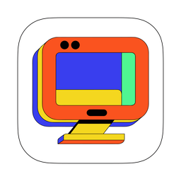

<p align="center"></p>

<h1 align="center">S.A.R.D.</h1>

<p align="center"><b>Use your other computers as if you were sitting at them.</b><br>
Fast remote desktop for Mac, Linux and Windows, made for 3D and game development.</p>

---

- **Feels local.** Your other computer's screen shows up in a window in a few
  milliseconds, smooth enough for Unity, Unreal, Blender and games.
- **Every screen.** Switch between the other computer's monitors with one click.
- **Sound and clipboard come along.** Copy text or a picture on one computer, paste it on the other.
- **Private.** Your computers pair once with a 6-digit code and only talk to each
  other, encrypted. No accounts needed.
- **From your iPhone too.** Control a computer's screen from your phone, or open a
  terminal on it.

## Install

**Mac or Linux:** paste this into Terminal:

```sh
curl -fsSL https://raw.githubusercontent.com/parodyband/StrangeApeRemoteDesktop/main/install.sh | sh
```

**Windows:** paste this into PowerShell:

```powershell
irm https://raw.githubusercontent.com/parodyband/StrangeApeRemoteDesktop/main/install.ps1 | iex
```

Sard appears in your menu bar (Mac) or system tray (Linux, Windows). Install it on
every computer you want to use together.

> Windows support is brand new and still being tested.

## Connect two computers

1. On both computers, open the Sard menu and choose **Pair a New Computer…**.
2. The computer you want to **control** shows an address and a 6-digit code. On
   the computer you're **sitting at**, click **Enter Code…** and type them in.
3. That's it. The Sard menu now has **Connect to** *that computer*. Click it any
   time to open its screen.

Both computers need to be on the same network the first time you pair them.

## While you're connected

- **Switch screens:** pick one under **Viewing** *that computer* in the Sard menu.
- **Shortcuts** (hold <kbd>Ctrl</kbd> <kbd>Alt</kbd> <kbd>Shift</kbd>; on a Mac,
  <kbd>Ctrl</kbd> <kbd>Option</kbd> <kbd>Shift</kbd>):

  | then press | to |
  |---|---|
  | <kbd>1</kbd> … <kbd>9</kbd> | show screen 1–9 |
  | <kbd>D</kbd> | show the next screen |
  | <kbd>F</kbd> | go full screen, or back |
  | <kbd>M</kbd> | lock the mouse to the window (for games and 3D apps) |
  | <kbd>K</kbd> | refresh the picture if it looks wrong |
  | <kbd>Q</kbd> | disconnect |

- **Mac shortcuts just work:** between a Mac and a Linux or Windows computer, Sard
  swaps <kbd>⌘ Cmd</kbd> and <kbd>Ctrl</kbd>, so copy, paste and friends use the
  keys you're used to.
- **Games and 3D apps:** when an app on the other computer hides the mouse pointer
  to look around, Sard locks the mouse automatically (not yet when the other
  computer is a Mac; use the <kbd>M</kbd> shortcut there).

## On your iPhone

The Sard iPhone app shows and controls your computers' screens, and opens
terminals on them. It isn't on the App Store yet: build it from this repository
with Xcode (see [docs/TECHNICAL.md](docs/TECHNICAL.md#iphone-app)).

- **Pair:** on the computer choose **Pair a New Computer…** and scan the QR code it
  shows, with the iPhone's Camera or **Scan Pairing Code** in the app. (Typing the
  address and code works too.) `sard host --pair` prints the QR code in the
  terminal.
- **Screen:** drag to move the pointer, tap to click, two-finger tap to
  right-click, hold then drag to drag, two fingers to scroll, pinch to zoom. The
  keyboard button brings up the keyboard with Esc, Tab, Ctrl, Alt, ⌘ and arrow
  keys; hardware keyboards work too. Prefer tapping where you want to click? Switch
  the pointer to **Touch**.
- **Fit Screen to Phone** (on by default) lowers the computer's resolution while
  you're connected so text is readable on the phone, and puts it back when you
  leave. Choose how big text gets under **Settings → Text Size**.
- **Terminal:** first turn on **Settings → Allow Terminal Access** in the Sard menu
  of that computer. Terminals keep running when you switch apps or lose signal;
  the app picks them up again when you're back.

## Terminals from another computer

With **Allow Terminal Access** on, open a terminal on a paired computer from a
terminal on this one:

```sh
sard shell linux                # a new terminal
sard shell linux --list         # terminals still running there
sard shell linux --attach 3     # pick one up again
```

Type <kbd>Enter</kbd> <kbd>~</kbd> <kbd>.</kbd> to disconnect and leave the
terminal running.

## Connect from anywhere

Away from home? Sard can still reach your computers over the internet,
without setting up your router. This is **invite-only for now; paid plans are
coming soon.**

If you have an invite code: on each of your computers, choose **Settings →
Connect Anywhere (Invite Only)…** and paste the same code. Pair your computers once at home, and
they'll find each other from any network after that.

## First-time setup

**Mac:** to let other computers see and control your Mac, Sard needs two
permissions. The Sard menu shows a shortcut to each one that's missing:

- **Screen & System Audio Recording**, to share your screen and sound
- **Accessibility**, so your keyboard and mouse work remotely

**Linux:** the first time someone connects, your desktop asks which screens to
share. Select **all** of them if you want to switch between screens. Sard remembers
your answer; **Choose Screens to Share…** in the menu asks again.
Copying pictures between computers needs `wl-clipboard` (`sudo apt install
wl-clipboard`, `sudo dnf install wl-clipboard` or `sudo pacman -S wl-clipboard`); text
works without it.

**Windows:** allow Sard through Windows Firewall when asked (the first time your PC
is shared).

## Tips

- **Smoother from a Mac on Wi-Fi:** AirDrop and Handoff make a Mac's Wi-Fi pause
  briefly a few times a second, which shows up as small jerks. If Sard notices, its
  menu offers **Turn Off AirDrop & Handoff…**. Turning them off while you work
  smooths things out. A wired connection avoids it completely.
- **Something stuck?** <kbd>Ctrl</kbd> <kbd>Alt</kbd> <kbd>Shift</kbd> <kbd>K</kbd>
  refreshes the picture. Disconnecting and connecting again fixes almost everything
  else.

## Updates

Sard checks for updates on its own and asks before installing. You can also
choose **Check for Updates…** in the menu any time.

<details>
<summary>Uninstall, manual download</summary>

- **Mac:** quit Sard and move it to the Trash.
- **Linux:** `curl -fsSL https://raw.githubusercontent.com/parodyband/StrangeApeRemoteDesktop/main/install.sh | sh -s -- --uninstall`
- **Windows:** `$env:SARD_UNINSTALL=1; irm https://raw.githubusercontent.com/parodyband/StrangeApeRemoteDesktop/main/install.ps1 | iex`

Downloads for every platform are on the
[releases page](https://github.com/parodyband/StrangeApeRemoteDesktop/releases/latest).
Sard needs a Mac with Apple Silicon (macOS 13 or later), a Linux PC with an NVIDIA
graphics card, or a Windows 10/11 PC.
</details>

## For developers

How Sard works, benchmarks, building from source, the command line and debugging
tools are in [docs/TECHNICAL.md](docs/TECHNICAL.md). Releasing is described in
[docs/RELEASING.md](docs/RELEASING.md).

## License

MIT. See [LICENSE](LICENSE).
